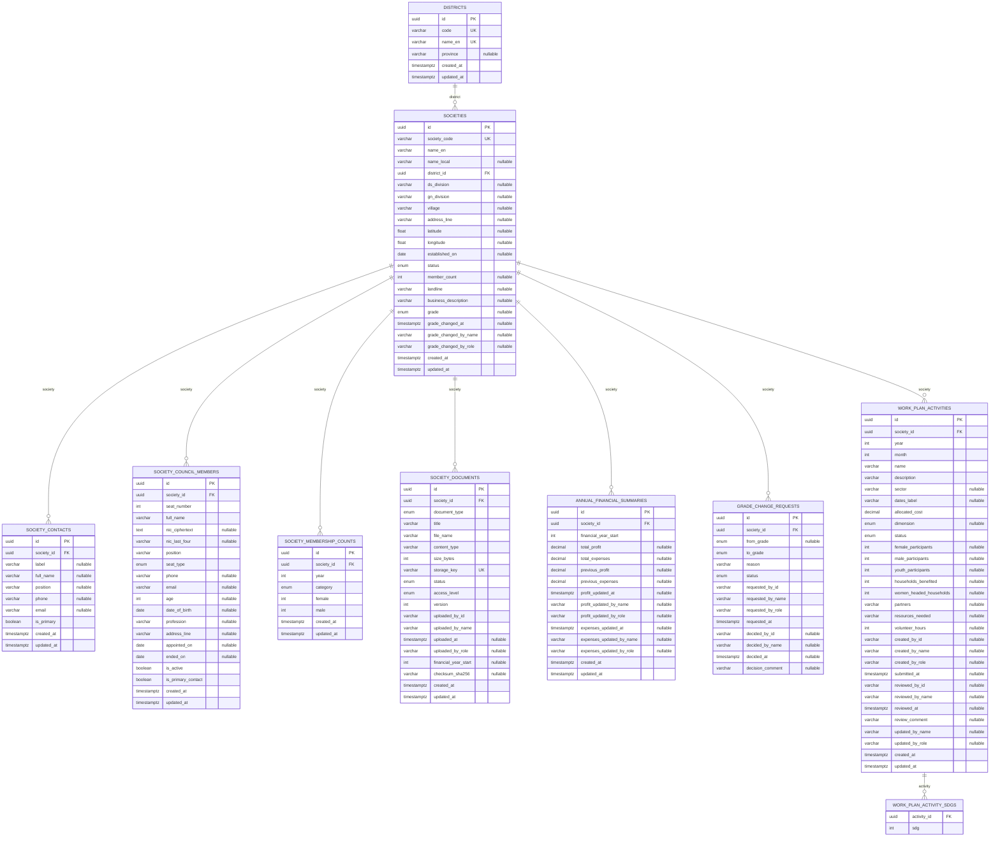
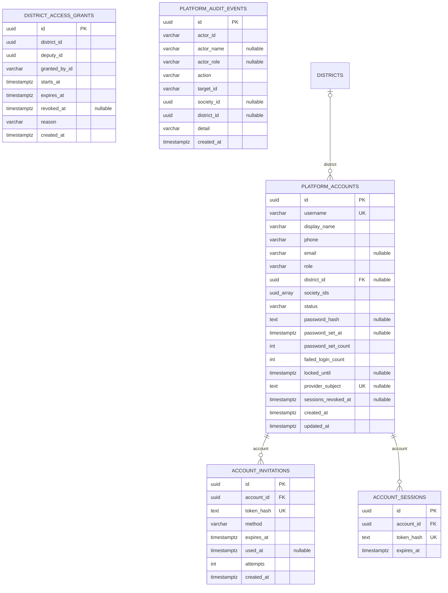
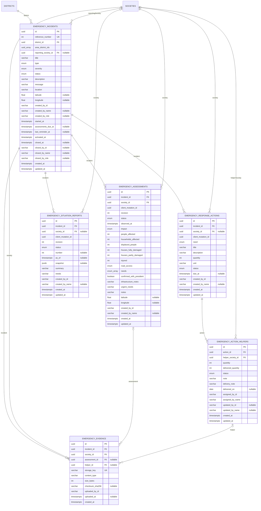
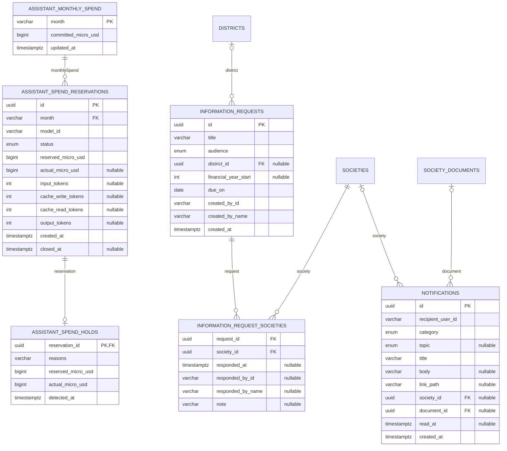

# Database schema reference

Derived from [`schema.prisma`](../apps/api/prisma/schema.prisma) on 11 November 2026.
All 31 Prisma models are included below. Field names use their mapped PostgreSQL
column names. Types are abbreviated; consult Prisma for enum values, lengths,
defaults, composite constraints and delete actions. `nullable` means the scalar
column is optional. Connections represent declared Prisma relations only. PK/UK field labels show
single-column declarations; composite keys and uniqueness are listed explicitly
in the constraint section below.

This documents repository migrations, not a live inspection of RDS. Apply reviewed
migrations separately; do not use this document as SQL or a migration tool.

UUID-looking scalar fields and arrays are not automatically database foreign keys.
In particular, account society assignments, temporary grants, audit target/actor
IDs, notification recipients and incident area-district arrays are enforced or
interpreted by application code where no Prisma relation is declared.

## Registry, records and activities



## Accounts and access



## Emergency response



## Notifications, requests and AI spending



## Village Economic Profile (issue #145)

Businesses the society itself operates and the production reported for exact
covered periods. See [Village Economic Profile](village-economic-profile.md)
for the rules. Industry, product and unit are catalogue codes from
`packages/api-contracts/src/economy.ts`, checked by the API; the database
checks quantities, periods and Other descriptions.

```mermaid
erDiagram
    SOCIETY_BUSINESSES {
        uuid id PK
        uuid society_id FK
        varchar name
        varchar industry
        varchar other_industry "nullable"
        varchar description "nullable"
        enum status
        timestamptz closed_at "nullable"
        int version
        varchar created_by_id
        varchar created_by_name
        varchar created_by_role "nullable"
        varchar updated_by_name "nullable"
        varchar updated_by_role "nullable"
        timestamptz created_at
        timestamptz updated_at
    }
    BUSINESS_OUTPUTS {
        uuid id PK
        uuid business_id FK
        varchar product
        varchar other_description "nullable"
        varchar unit
        timestamptz archived_at "nullable"
        int version
        varchar created_by_id
        varchar created_by_name
        varchar created_by_role "nullable"
        timestamptz created_at
        timestamptz updated_at
    }
    PRODUCTION_RECORDS {
        uuid id PK
        uuid output_id FK
        enum basis
        date period_start
        date period_end
        varchar season_label "nullable"
        enum measurement
        decimal quantity
        varchar note "nullable"
        varchar source "nullable"
        int version
        uuid client_request_id UK "nullable"
        varchar created_by_id
        varchar created_by_name
        varchar created_by_role "nullable"
        varchar updated_by_name "nullable"
        varchar updated_by_role "nullable"
        timestamptz created_at
        timestamptz updated_at
    }
    PRODUCTION_RECORD_REVISIONS {
        uuid id PK
        uuid record_id FK
        int version
        varchar change
        decimal quantity
        varchar season_label "nullable"
        varchar note "nullable"
        varchar source "nullable"
        varchar changed_by_id
        varchar changed_by_name
        varchar changed_by_role "nullable"
        timestamptz changed_at
    }
    SOCIETIES ||--o{ SOCIETY_BUSINESSES : society
    SOCIETY_BUSINESSES ||--o{ BUSINESS_OUTPUTS : business
    BUSINESS_OUTPUTS ||--o{ PRODUCTION_RECORDS : output
    PRODUCTION_RECORDS ||--o{ PRODUCTION_RECORD_REVISIONS : record
```



## Composite keys, unique constraints and indexes

### `societies`

```prisma
@@index([districtId])
@@index([status])
@@index([status, updatedAt])
@@index([nameEn])
```

### `society_contacts`

```prisma
@@index([societyId])
```

### `society_council_members`

```prisma
@@unique([societyId, seatNumber])
@@index([societyId, isActive])
```

### `society_membership_counts`

```prisma
@@unique([societyId, year, category])
@@index([year, societyId])
```

### `society_documents`

```prisma
@@unique([societyId, documentType, title, version])
@@index([societyId, documentType])
@@index([societyId, documentType, financialYear])
@@index([financialYear, documentType, societyId])
@@index([status])
```

### `annual_financial_summaries`

```prisma
@@unique([societyId, financialYear])
```

### `grade_change_requests`

```prisma
@@index([societyId, requestedAt])
@@index([status, requestedAt])
```

### `work_plan_activities`

```prisma
@@index([societyId, year, month])
@@index([status, submittedAt])
@@index([status, reviewedAt])
```

### `work_plan_activity_sdgs`

```prisma
@@id([activityId, sdg])
@@index([sdg])
```

### `notifications`

```prisma
@@index([recipientUserId, createdAt])
@@index([recipientUserId, readAt])
@@index([recipientUserId, topic, createdAt])
```

### `emergency_incidents`

```prisma
@@index([districtId, status, activatedAt])
@@index([areaDistrictIds], type: Gin)
@@index([status, activatedAt])
```

### `emergency_assessments`

```prisma
@@unique([createdById, clientMutationId])
@@index([incidentId, societyId, status])
@@index([incidentId, status, createdAt])
```

### `emergency_response_actions`

```prisma
@@unique([createdById, clientMutationId])
@@index([incidentId, status, dueAt])
@@index([societyId])
```

### `emergency_action_helpers`

```prisma
@@unique([actionId, helperSocietyId])
@@index([helperSocietyId])
```

### `emergency_evidence`

```prisma
@@index([assessmentId])
@@index([helperId])
```

### `emergency_situation_reports`

```prisma
@@unique([createdById, clientMutationId], map: "emergency_situation_reports_created_by_id_client_mutation_i_key")
@@unique([incidentId, number])
@@index([incidentId, status, createdAt])
```

### `platform_accounts`

```prisma
@@index([districtId, role])
```

### `account_sessions`

```prisma
@@index([accountId])
```

### `district_access_grants`

```prisma
@@index([deputyId, expiresAt])
```

### `platform_audit_events`

```prisma
@@index([createdAt])
@@index([societyId, createdAt])
@@index([action, targetId])
```

### `information_requests`

```prisma
@@index([createdAt])
```

### `information_request_societies`

```prisma
@@id([requestId, societyId])
@@index([societyId, respondedAt])
@@index([requestId, respondedAt])
```

### `assistant_spend_reservations`

```prisma
@@index([month, status])
```

### `assistant_spend_holds`

```prisma
@@index([detectedAt])
```

### `society_businesses`

```prisma
@@index([societyId])
```

### `business_outputs`

```prisma
@@index([businessId])
@@index([product])
```

Also, in the migration only: `business_outputs_one_current_product`, a unique
index on `(business_id, product)` where `archived_at IS NULL AND product <> 'OTHER'`.

### `production_records`

```prisma
@@unique([outputId, measurement, periodStart, periodEnd])
@@index([periodStart, periodEnd])
```

### `production_record_revisions`

```prisma
@@unique([recordId, version])
```
