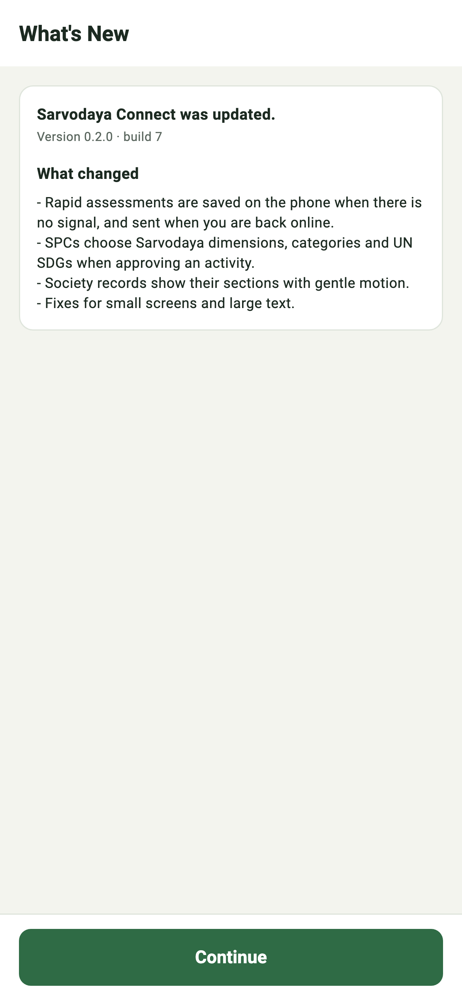
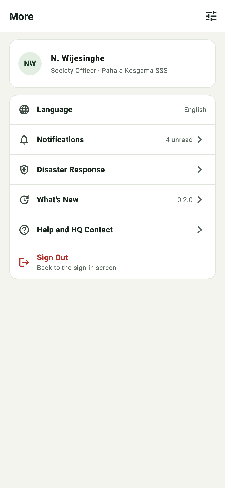
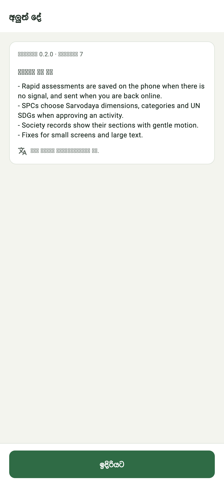
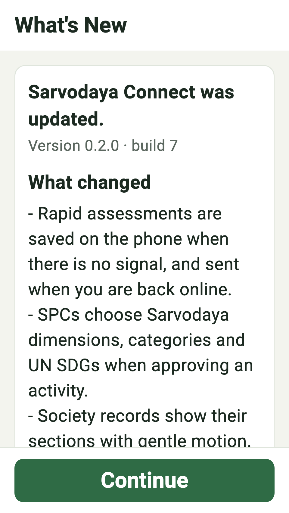
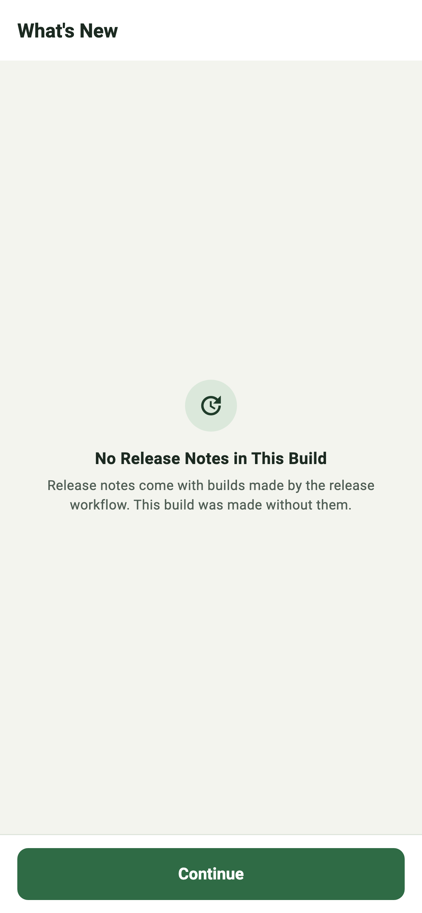

# What's new on the phone (issue #161)

After an app update, the phone shows the installed release's notes once, with one **Continue** button. They are also always under **More → What's new**.

## Where the notes come from

The release owner writes the notes once, in the **release notes** box of the release workflow:
- **Android internal release:** the same text goes to Google Play.
- **iOS internal release:** the same text is kept as TestFlight's *What to Test*.

`scripts/release_metadata.py` checks the notes and embeds them in the build, before compilation, through the existing dart-define file:
- The notes are stripped and must be 1–500 characters of plain text. Line breaks and tabs are allowed; other control characters are refused. This is the same stripped text that `publish_internal.py` sends to Play.
- They are base64-encoded (`SC_RELEASE_NOTES_B64`), so quotes, `$`, backticks, newlines and Sinhala, Tamil or emoji reach the app byte for byte. They are never placed in shell code, and the app shows them as plain text, never as markup.
- The installed release is identified by version and build (`SC_RELEASE_VERSION`, `SC_RELEASE_BUILD`), for example `0.2.0+7`. Re-running the same build is the same release, so it never asks again after Continue.

Nothing is fetched at runtime: the notes work offline. Missing or invalid metadata (local runs, tests, a broken value) simply means "no release notes": the app starts as normal and More → What's new says the build has none.

## When it is shown

- **After an update:** once, after sign-in, over the home screen the user just reached. Continue (or back) returns there. Sign-in, start-up and the language choice are never interrupted.
- **Several versions skipped:** only the installed release's notes, never a series of old screens.
- **Fresh installation:** not described as an update and not shown. The release is recorded as seen, and its notes are under More → What's new.
- **Once acknowledged:** not again for that release, after restarts or signing out and in. The record is kept on the phone (`whatsNew.acknowledged`), not per account.

The app tells an update from a fresh installation by whether it had saved anything on the phone before this launch, such as the chosen language. One limit applies the first time this feature ships: on a phone that had saved nothing before (an English-only build never saves the language), the update looks like a fresh installation, so the notes are only under More → What's new. From then on every update is detected, because the seen release is always recorded.

## Language

The screen's labels are in English, Sinhala or Tamil like the rest of the app. The notes are written once, in English, for the stores as well. In Sinhala or Tamil the screen says "These notes are in English", and the notes are marked as English for screen readers. Nothing untranslated is labelled as translated.

## Preview locally

```bash
printf 'Rapid assessments are saved on the phone.\nSPCs choose Development Goals.\n' > /tmp/notes.txt
python3 scripts/release_metadata.py --version 0.2.0 --build 7 --notes-file /tmp/notes.txt > /tmp/whats-new.json
cd apps/mobile && flutter run --dart-define-from-file=/tmp/whats-new.json
```

Open More → What's new to see the notes. To see the after-update screen, run once with `--version 0.1.0 --build 1` (recorded as a fresh installation), then again with `0.2.0` / `7`: it appears after sign-in.

Without a define file (an ordinary `flutter run`, or iOS builds made outside the workflow) the app has no release notes and works as before.

## Screens

| After an update | More | From More, in Sinhala | Small phone, large text | Build without notes |
|---|---|---|---|---|
|  |  |  |  |  |

These are rendered from the real widgets in a Flutter test with Roboto, the Material icons and a Sinhala system font loaded. They are not a device capture.
